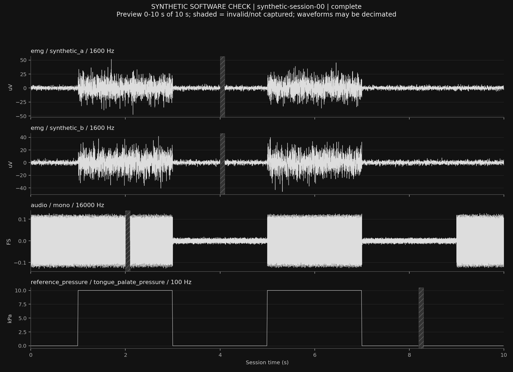

# Aerway Arc

Two research pipelines: daytime EMG hold classification and nighttime audio respiratory-event candidates. **169 tests pass. All supplied recordings and trained models are synthetic software checks.**

[Source code](repo/) · [Architecture](repo/docs/architecture.pdf) · [Saved session](evidence/sample-session/) · [Awake baseline](evidence/baselines/awake/) · [Night baseline](evidence/baselines/night_audio/) · [Crash recovery proof](evidence/crash/recovery-proof.json)



## Implementation review bundle

All recordings and model outputs here are SYNTHETIC SOFTWARE EVIDENCE. No human data, clinical accuracy or completed hardware validation is claimed.

## Inspect

- `repo/`: complete standalone source snapshot, tests and updated architecture.
- `evidence/sample-session/session.json`: one complete held-out sample with EMG, microphone and separate pressure reference.
- `evidence/sample-session.png`: recorded channels, actual session seconds, units and hatched invalid ranges.
- `evidence/replay/`: exact sample CSV files and channel/time/validity audit.
- `evidence/baselines/awake/` and `night_audio/`: fitted JSON models, frozen splits, validation report, held-out report and sample predictions.
- `evidence/dataset/`: all ten synthetic participants, making both baseline runs reproducible.
- `evidence/crash/`: interrupted source, recovered session, replay, plot and real SIGKILL process proof.
- `checks/`: executed tests and machine-readable JUnit results.
- `repo/docs/reference-selection.html`: selected real instrument and unresolved synchronization/clinical-criteria gates.

## Verify after extracting

Recorder/crash evidence was tested on the POSIX platform listed in environment.json. Windows recorder behavior is not qualified.

From this directory, with the tested Python version and listed dependencies:

```sh
python3 -m pip install -r requirements-tested.txt
python3 -m pip install --no-deps -e repo
python3 repo/scripts/verify_handoff.py .
python3 -m arc validate-session evidence/sample-session
python3 -m arc check-reference evidence/sample-session
python3 -m arc replay-session evidence/sample-session --output replay-again
python3 -m arc plot-session evidence/sample-session --output plot-again.png
python3 -m arc predict evidence/sample-session --model evidence/baselines/awake/model.json --output predict-again.json
python3 -m arc evaluate evidence/dataset/manifest.json --model evidence/baselines/awake/model.json --output test-again.json
```

Reproduce fitting using frozen participant IDs:

```sh
python3 -m arc train evidence/dataset/manifest.json --splits evidence/splits.json --task awake --allow-synthetic --output awake-again
python3 -m arc train evidence/dataset/manifest.json --splits evidence/splits.json --task night_audio --allow-synthetic --output night-again
```

The verifier checks archive-file hashes, exact CSV values/timestamps/validity, pressure-reference conversion, model replay, fresh baseline refitting, held-out report reproduction and recovered crash samples. Numeric model/report comparisons permit 1e-10 relative / 1e-12 absolute floating-point tolerance; structural fields stay exact. Assertions must remain enabled. Processing durations are measured again and intentionally are not compared bit-for-bit.

Crash guarantee: append acknowledges only after data and checkpoint sync. A failed in-flight append can leave orphan files; recovery ignores them. Earlier committed chunks remain readable. Recovered sessions remain incomplete and cannot enter model training/evaluation. Actual power failure, filesystem durability and BLE behavior still require hardware tests.

Actual awake reference selected: JMS TPM-02 plus manufacturer recording software. Real thresholds, placement and approval have not been fabricated. The synthetic 5 kPa / 0.1 s values only exercise code; they are not recommendations for people.
